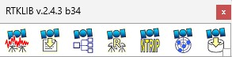

# RTKLIB ver 2.4.3_b34

This is a personal repository for RTKLIB ver 2.4.3_b34 working on Windows 11 as some bugs and issues were found in my computer when trying to work with the software.

Those issues are fixed and merged folders here to work properly on Windows 11.

## Usage

It contains all the Source Programs and Data, just launch:

RTKLIB-rtklib_2.4.3_b34 --> bin --> rtklaunch

And select the module from RTKLIB that you want to use.

## License

All credits to RTKLIB:
https://www.rtklib.com/

And tomojitakasu in GitHub:
https://github.com/tomojitakasu/RTKLIB